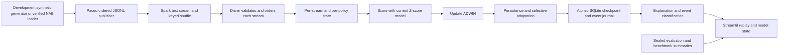

# Architecture

The scientific evaluation and the operational demonstration share detector implementations. Their inputs, timing and output policies are separate. The sealed evaluation measures predictive performance and update cost on fixed splits. The development-only demonstration measures delivery behavior and exposes the decisions recorded by those same detectors.

## Research execution path

The offline runner iterates through each stream in chronological order. Warm-up fits only on the first 256 observations. The anomaly detector scores the current point before the current value can update ADWIN or change the fitted model. Evaluation joins anomaly and synthetic drift truth after scoring. Point metrics, event-window FPR, and the paired seed-block analysis have frozen definitions. Neither NAB nor synthetic truth flows into the update rule. NAB lacks independent drift truth.

The original execution SHA, executable fingerprint, and artifact hashes are preserved in the [executed receipt](../configs/final_evaluation.yaml). The project does not rerun final evaluation during setup or packaging.

## Streaming demonstration path

The paced producer deterministically interleaves selected streams and publishes one immutable file per emission. Rate and replay speed determine how many rows are admitted per interval. Spark schedules Structured Streaming micro-batches and repartitions by stream ID inside each callback. A bounded driver collection validates fields and restores index order, independent of partition return order. The sink rejects skipped or duplicated indices, reversed timestamps, invalid values, and any extra label fields.

State is keyed by stream ID and method. A SQL transaction writes the warm-up prefix, model, River ADWIN state, candidate buffer, cooldown, refit budget, position cursor, event output and normalized batch receipt. Spark owns the source offsets. A retry after durable SQL commit verifies the receipt and skips applying the batch again. Preserve both checkpoint halves and trusted version-compatible SQLite state for recovery. This architecture uses one local driver to apply each stream's sequential state transitions.

The explanation layer reads only the committed journal. It preserves the scoring-time reference and shows any training result separately. Event priority is adapted, confirmed persistence, ADWIN suspicion, anomaly, then normal. Every classification preserves the original flags. An ADWIN alarm may be suppressed by budget or cooldown. Passing persistence may still fail retained-count or budget checks. Candidate membership is retrospective and is tagged with the exact checkpoint and whether the value entered a real refit. Display overlays come from the synthetic generator and are optional.

A Streamlit session starts a development-only local Spark subprocess and reads the prediction journal through a read-only SQLite connection. Reset terminates that replay and clears the view while preserving its ignored artifact directory. Pause holds the display while Spark keeps running. Research result tables use the lightweight published package and never start a research job.

More detail is available in the [Spark guide](spark_streaming.md) and [reproduction workflow](REPRODUCIBILITY.md).
