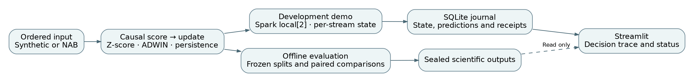
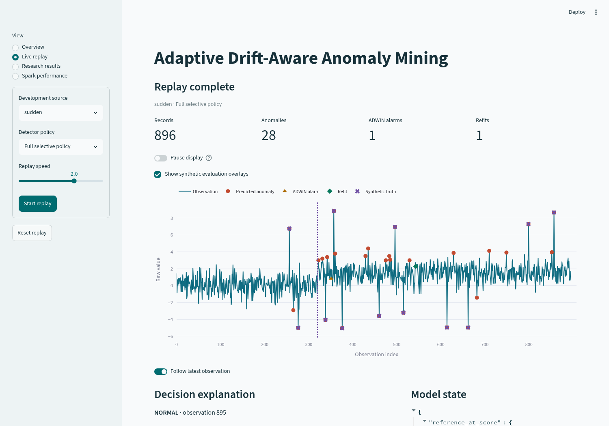
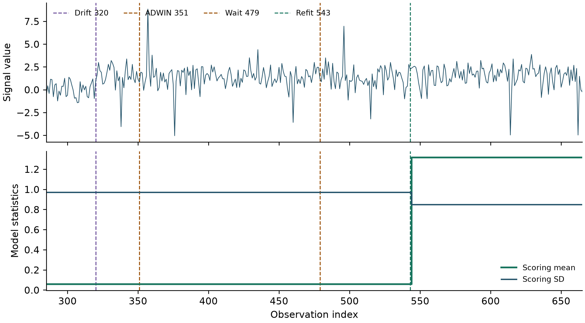
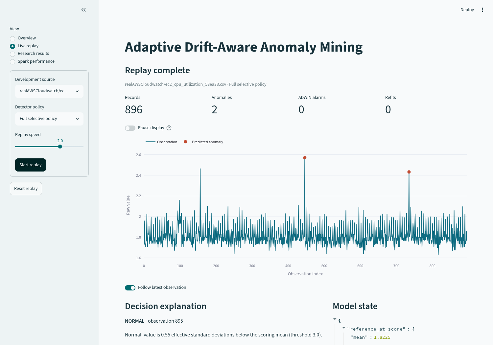
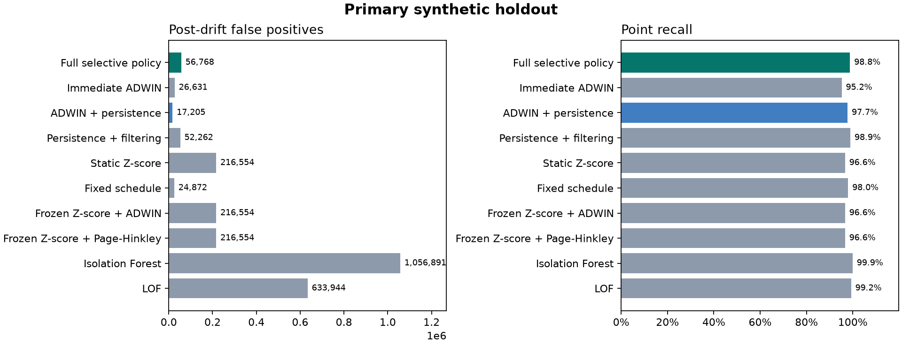
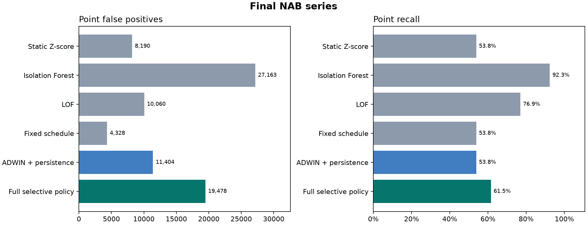
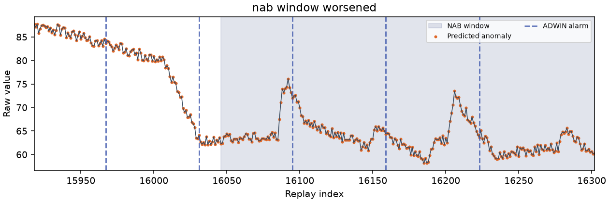
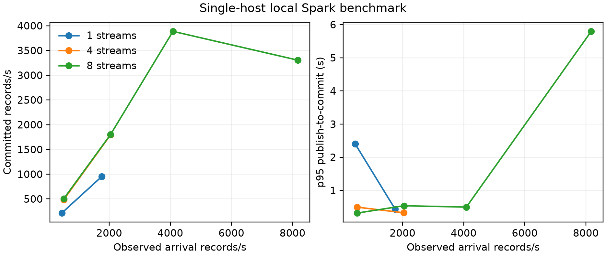

Use this sequence when Spark or the dashboard is unavailable. The screenshots are from verified development replays. The result tables and failure plot come from the recorded evaluation. The HTML export embeds the images and runs locally without a server or internet connection.

## 0:00–0:35 — Research question and architecture

Can explicit concept-drift detection and selective model adaptation reduce false anomaly alarms after distribution changes without reducing sensitivity to genuine anomalies?

The offline scientific path produces the sealed comparisons. The Spark path demonstrates the same score-before-update logic on development data. Detector state and events are committed together, and the dashboard reads the resulting journal.



## 0:35–1:25 — Isolated anomaly versus sustained change

Point to the anomaly prediction at observation 256 (absolute Z-score 6.905; threshold 3.0) before the planted sudden change at 320. The injected-anomaly overlay is an evaluation aid. The scoring model receives only observation values.



## 1:25–3:45 — Alarm, persistence and refit

| Index | Recorded event | Narration |
| ---: | --- | --- |
| 351 | ADWIN alarm | An alarm opens a candidate. The point’s anomaly score is below threshold. |
| 479 | Persistence passed; 121 retained | The two median blocks pass. The minimum of 128 retained observations is unmet, so the policy waits. |
| 543 | 180 retained; refit after scoring | This point still uses version 0. The model mean changes from about 0.0582 to 1.3163, and its standard deviation from 0.9695 to 0.8479. |
| 544 | Version 1 scores the next point | New scoring state and cooldown are active. The journal preserves the original prediction at 543. |



## 3:45–4:35 — NAB demonstration

This is a verified 896-observation prefix of the CloudWatch CPU development file. Show the absence of synthetic overlays. NAB supplies anomaly annotations for evaluation and has no independent concept-drift labels.



## 4:35–5:35 — Sealed outcomes and a failure

| Final outcome | Static Z-score | Full selective policy |
| --- | ---: | ---: |
| Synthetic post-drift false positives | 216,554 | 56,768 |
| Synthetic isolated anomalies detected | 5,798 / 6,000 | 5,926 / 6,000 |
| Final NAB point detections | 7 / 13 | 8 / 13 |
| Final NAB point false positives | 8,190 | 19,478 |

The synthetic paired event-window FPR difference was −2.005 percentage points and recall changed +2.222 points. Both frozen criteria passed. On final NAB, one additional exact-point detection came with 11,288 additional false positives. The failure figure shows a machine-temperature window where the secondary persistence policy retained the window hit and added 115 point false positives.







## 5:35–6:30 — Spark performance and conclusion

| Eight-stream workload | Committed rows/s | p95 publish-to-commit | Peak backlog |
| ---: | ---: | ---: | ---: |
| Target 4,096 rows/s | 3,886 | 0.50 s | 3,072 |
| Target 8,192 rows/s | 3,304 | 5.79 s | 21,300 |



The sealed evaluation supports selective adaptation on controlled synthetic streams versus static Z-score. It shows a real-benchmark false-positive trade-off and a substantially lower synthetic refit count than fixed scheduling. The Spark measurements are finite, local CPU trials at different trigger intervals. They leave long-run capacity and distributed scalability unmeasured.


## Opening the saved HTML on a managed machine

Some managed browsers block `file://` navigation. Serve just the release directory over loopback and open `http://127.0.0.1:8782/Offline_Faculty_Demo.html`. This starts only Python’s static file server.

```bash
python3 -m http.server 8782 --bind 127.0.0.1 --directory results/release-candidate
```
