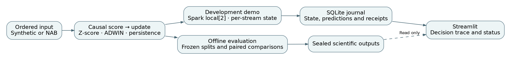
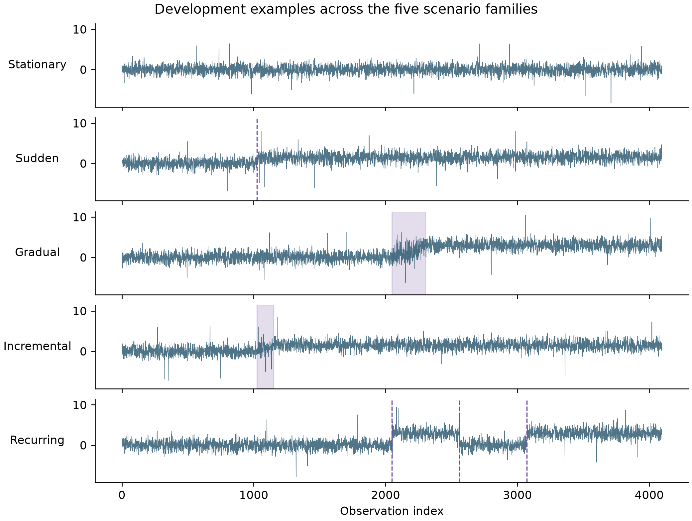
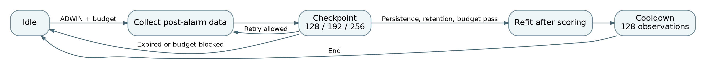
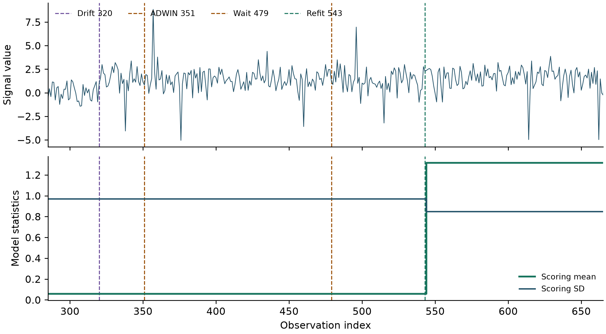
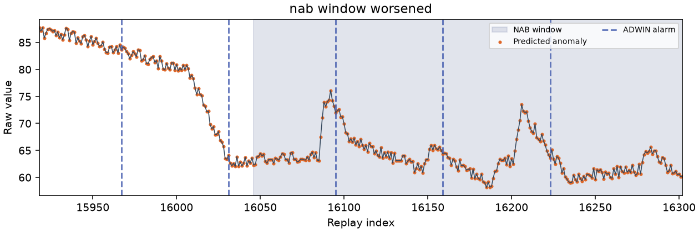

## 1. Title page and submission details

- **Project title** — Adaptive Drift-Aware Explainable Streaming Anomaly Mining
- **Submission** — Final-year project report
- **Student and registration number** — [Enter institutional details]
- **Programme, department, and institution** — [Enter institutional details]
- **Project supervisor** — [Enter supervisor name]
- **Submission date** — [Enter institutional submission date]

The project implements a causal streaming anomaly detector and evaluates a frozen drift-triggered refit policy against shared static, periodic, and adaptive controls. The sealed evaluation ran at Git revision `7e72ccb61297d58567fb1e41c077e6b537e9d897`. [Evaluation receipt](../configs/final_evaluation.yaml)

## 2. Abstract

A static anomaly detector can continue flagging ordinary observations after the normal process changes. We evaluate a selective Z-score refit policy using ADWIN alarms, a two-block median persistence check, prediction-based filtering, and a cooldown. The primary holdout comprises 1,000 synthetic streams per method with independently known shifts and injected anomalies. A held-out five-series NAB subset provides separate real-benchmark evidence. Against static Z-score, the full policy lowered paired event-window false-positive rate by 2.005 percentage points and raised paired isolated-anomaly recall by 2.222 points. Both prespecified criteria passed. On final NAB the same policy gained one exact-point detection and produced 11,288 additional point false positives. The full policy used 1,326 synthetic refits versus 15,000 for periodic updates. A development-only Spark Structured Streaming demonstration preserves score-before-update behavior, recovers per-stream state, and exposes the evidence behind alarms and refits.

## 3. Introduction

Streaming models operate without the final observations or labels that become available in retrospective analysis. A detector must decide on the current sample while its reference can become stale. This project separates the decision to flag a point from the decision to replace the model. A frozen study measures predictive and update-cost outcomes. A separate engineering track demonstrates the identical update logic with micro-batches, recovery, and a read-only explanation view.

## 4. Motivation

Repeated false alarms make a monitoring system hard to use. Updating on every alarm can absorb the event the system is supposed to detect. Updating on a fixed schedule can spend compute during stable periods, and a late update can miss a short-lived change. A drift-triggered policy is useful only if its sensitivity, delay, and actual update count are measured together.

## 5. Problem statement

At index $t$, a scalar $x_t$ arrives. A point decision uses the model state available immediately before $t$. A later update can affect predictions starting at $t+1$. In this unsupervised setting, drift refers to a sustained change in the observed distribution; an anomalous point is an isolated deviation under the evaluation protocol. Synthetic ground truth identifies both kinds of event. NAB offers point and window annotations for anomalies.

## 6. Research question

Can explicit concept-drift detection and selective model adaptation reduce false anomaly alarms after distribution changes without reducing sensitivity to genuine anomalies?

## 7. Objectives and contributions

1. Build a reproducible, score-before-update framework that separates simulated transitions, isolated injections, and model events.
2. Evaluate a selective ADWIN-triggered update mechanism against static, drift-only, and periodic controls using the same chronological inputs.
3. Report paired post-change performance, comparator dependence, matched delays, and actual update costs.
4. Test fixed synthetic holdouts and present the five-series NAB results as complementary anomaly evidence.
5. Demonstrate the same policy in Spark and expose a trace of the scoring model, candidate decisions, and later refits.

The contribution is the combination of a specified policy, matched comparisons, evidence on both benefits and failure modes, and a verifiable operational realization.

## 8. Literature review

Chandola et al. [1] survey the meanings and use cases of anomaly detection. Gama et al. [2] survey drift detection and adaptation strategies. The static comparators represent distinct scoring principles. Isolation Forest isolates rare points with randomized partitions [3]. LOF evaluates density relative to nearby points [4].

ADWIN estimates change from a data-dependent window [5]. Page’s sequential inspection work [6] and Hinkley’s change-point inference [7] provide historical context for the Page–Hinkley baseline. The implementation uses River’s two-sided Page–Hinkley configuration. Recent work on Online Isolation Forest updates a tree ensemble incrementally for evolving streams [8]. It provides an alternative adaptation design outside the frozen comparator set.

NAB supplies a streaming benchmark with anomaly timing and windows [9]. Broad time-series evaluations show the value of comparing methods across differing data characteristics and metric choices [10]. Lipton [11] distinguishes different forms of interpretability. This project offers decision provenance grounded in the detector’s own state. Structured Streaming provides the declarative execution substrate [12]. [Verification ledger](academic/CITATION_AUDIT.md)

## 9. Research gap

The question addressed here is how far a low-complexity, explicitly gated location/scale update can separate isolated anomalies from sustained shifts, and how many updates its measured behavior requires. A detector alarm by itself says little about whether a proposed refit is appropriate. Existing adaptive methods motivate the question, while this study isolates the effects of the trigger, persistence, filtering, and cooldown in one specified setting. No claim of first discovery follows from these comparisons.

## 10. System architecture

The scientific path uses deterministic offline replay and performs truth joins after inference. The development demonstration places the same detector behind Spark; the driver commits model state and the explanation journal in a single SQLite transaction. The dashboard reads the journal and the sealed publication summary. [Architecture and control boundaries](ARCHITECTURE.md)

## 11. Dataset description

The primary synthetic evaluation scored 3,840,000 observations per method from 1,000 traces of length 4,096. The 500 clean/injected pairs contributed 6,000 isolated anomalies and 1,280 transitions across both pair members. The 20 primary seeds span 1000–1019.

The project pins five development and five final NAB series by source revision and checksum. The final series cover known events, ad traffic, and artificial controls. The final comparison scores 41,326 rows per method with 13 eligible exact points and 13 eligible windows. The machine-temperature stream contributed 22,428 scored rows. The causal loader retains timestamp ties in source order and skips rows whose timestamps precede the last retained timestamp. Eleven rows were skipped in that file. [Dataset manifest and audit](dataset_protocol.md)

## 12. Synthetic drift generation

Stationary examples remain in regime A. Sudden examples switch directly to B. Gradual examples draw from two regimes with a linearly changing mixture probability. Incremental examples interpolate the distribution parameters while this protocol keeps unit standard deviation. Recurring examples return to A before a second switch to B. Holdout onsets are 1536 and 2560, shifts are 1 and 2.25, and ramp durations are 192 and 384. A clean trace and its injected counterpart share the base signal. Injections independently add or subtract six pre-change standard deviations, subject to the placement and separation rules. [Generator documentation](synthetic_streams.md)

## 13. Anomaly-detection baselines

Static Z-score estimates the population mean and standard deviation on the first 256 observations. It flags an absolute score of at least 3.0 and floors the standard deviation at $10^{-12}$. Static Isolation Forest uses 100 trees, 256 maximum samples, seed 42, and automatic contamination. Static LOF uses a 20-neighbor Euclidean novelty model and automatic contamination. Each scores future values without updating. The forest and density baselines test whether alternate reference scoring changes the observed trade-off under drift. [Table A](academic/TABLES.md#table-a-static-anomaly-baselines)

## 14. Drift-detection baselines

Both ADWIN and Page–Hinkley receive raw values. ADWIN’s delta is 0.002, clock is 32, and grace period is 10. Page–Hinkley uses both directions, a minimum of 30 observations, delta 0.005, threshold 50, and alpha 0.9999. A drift-only control records their events without modifying the anomaly model. The two controls exactly reproduce static Z-score anomaly results. On aligned development, both monitors matched all 640 true transitions. ADWIN reported 142 unmatched alarms with median delay 63, while Page–Hinkley reported 1,066 and median delay 36.5. [Table B](academic/TABLES.md#table-b-drift-detector-comparison)

## 15. Proposed selective-adaptation framework

Let the pre-score reference be $(\mu,\sigma)$ and set $s=\max(\sigma,10^{-12})$. The absolute score is $|x_t-\mu|/s$. After scoring, ADWIN can open one candidate using the alarm-time reference. At 128, 192 and 256 post-alarm observations, the two most recent nonoverlapping 64-observation block medians must move at least $0.50s$ from $\mu$ in the same direction.

The full policy discards points flagged by the unchanged scoring model and requires at least 128 retained values and available budget. A refit uses no more than 256 post-alarm observations. It updates the model after the current score, clears the candidate, and imposes a 128-observation cooldown. Budget caps are 15 refits and 3,840 refit-input uses per 4,096-point trace. The secondary persistence policy omits filtering and cooldown. Immediate ADWIN refits its trailing 256 without waiting; fixed scheduling refits a trailing 256 every 256 observations. [Frozen decision rules](selective_adaptation_protocol.md)

## 16. Experimental protocol

Development data supported method choice. The separately characterized non-aligned robustness grid addressed onset alignment and retained its own role. The full policy’s comparison with static Z-score was the confirmatory primary contrast. Scoring did not use truth labels or future rows. Warm-up was separate from scored records. The confirmatory FPR is calculated on eligible nominal observations in an event window through 256 points after transition end, clipped before the next change. “Post-drift false positives” count flagged nominal points across the wider post-drift phase. NAB counts exact point detections separately from window hits. [Protocol and success criteria](experimental_protocol.md)

## 17. Development experiments

The aligned synthetic development grid used 500 traces. ADWIN was chosen as the trigger because it matched all development transitions with fewer unmatched alarms than Page–Hinkley. Persistence alone performed strongly on that grid and remained a development-selected secondary comparator when the full definition was frozen. Fixed scheduling’s advantage over persistence on non-aligned robustness later reversed on the primary holdout. Because the grids also differ in shifts, ramp widths, or seeds, the reversal cannot isolate the causal effect of onset alignment. [Development ablation](selective_adaptation_development.md) · [Robustness and NAB development](pre_final_validation.md)

## 18. Final synthetic holdout results

| Method | Post-drift FP | Point recall | Point FN | Refits |
| --- | ---: | ---: | ---: | ---: |
| Static Z-score | 216,554 | 96.63% | 202 | 0 |
| Fixed schedule | 24,872 | 97.95% | 123 | 15,000 |
| Immediate ADWIN | 26,631 | 95.18% | 289 | 1,534 |
| ADWIN + persistence | 17,205 | 97.72% | 137 | 1,430 |
| Full selective policy | 56,768 | 98.77% | 74 | 1,326 |

The full policy reduced post-drift FP by 73.8% against static Z-score and missed fewer point anomalies. Persistence had the lowest post-drift count among the evaluated policies, while immediate ADWIN had a lower pooled event-window FPR than persistence. Isolation Forest and LOF achieved 99.90% and 99.25% recall respectively at substantially higher false-positive costs. [Table C](academic/TABLES.md#table-c-adaptation-comparison) · [Table D](academic/TABLES.md#table-d-final-synthetic-holdout)

## 19. Final NAB results

Static Z-score hit 7/13 exact points, flagged 8,190 nominal points, and hit 9/13 windows. The full policy hit 8/13 exact points, flagged 19,478 nominal points, and hit 10/13 windows. Fixed scheduling hit 7/13 exact points and made 4,328 false-positive predictions. Both Isolation Forest and LOF hit all 13 windows, with point FPRs of 65.75% and 24.35%. False positives for the selective policies concentrated in the machine-temperature file. These labels cannot establish that any detected alarm corresponds to a real distribution shift. [Table E](academic/TABLES.md#table-e-final-nab-evaluation)

## 20. Statistical analysis

The seed is the resampling and paired-test unit. FPR involved 960 eligible paired streams and recall involved 480. The locked analysis used 10,000 paired seed-block bootstrap replicates with seed 1729. Wilcoxon signed-rank tests used seed means, omitting zero differences; Holm adjustment covered ten comparisons. Against static Z-score, the full policy’s event-window FPR effect was −2.005 percentage points with 95% CI [−2.407, −1.591], adjusted $p=0.0000267$, and rank-biserial effect −0.990. Recall was +2.222 points with CI [+1.233, +3.438], adjusted $p=0.000633$, and rank-biserial effect +1.000. The first interval lies below zero, and the second exceeds the frozen −5-point non-inferiority bound. The point estimates and pooled rates use different weights. NAB is descriptive. [Ten prespecified contrasts](final_evaluation.md#prespecified-statistical-comparisons)

## 21. Spark Structured Streaming implementation

Spark 4.1.1 runs on Java 21 in CPU-only `local[2]` mode. The paced producer writes immutable files. Spark uses keyed repartitioning, and a bounded driver callback restores index order for each stream and method. The callback writes prediction rows, detector state, and normalized batch identity in one SQLite transaction. Spark keeps source offsets. When an acknowledged database commit is replayed after a query interruption, the sink checks the receipt and avoids a second state update. Recovery tests cover warm-up, an open proposal, and cooldown. [Streaming instructions](spark_streaming.md)

## 22. Performance benchmark

Eight development-only paced workloads exercised one, four, or eight streams. All matched Python replay with zero dropped or failed records. The eight-stream 4,096-record/s target achieved 3,886 committed rows/s, with 0.50 s p95 publish-to-commit latency and peak backlog 3,072. At the 8,192 target with shorter triggers the committed rate fell to 3,304 rows/s and peak backlog reached 21,300. These are finite local tests with varying intervals. Cluster scaling was outside evaluation.

The full policy used 1,326 refits and 225,242 input uses, versus 15,000 and 3,840,000 for fixed scheduling on primary synthetic holdout. Its 287-observation median matched refit delay was higher than 255 for fixed scheduling. Fewer refits and lower runtime are distinct outcomes. [Table F](academic/TABLES.md#table-f-update-efficiency) · [Table G](academic/TABLES.md#table-g-single-host-local-spark-benchmark)

## 23. Explainability and dashboard

The journal distinguishes pre-update model statistics from any later refit. Explanations expose the score, threshold, signed deviation, ADWIN disposition, persistence result, candidate counts, and refit state. Status labels prioritize refit, confirmed persistence, drift suspicion, anomaly, then normal; raw flags remain visible. Synthetic truth overlays are optional evaluation aids. A retained-value annotation is retrospective because the decision is made only at a later checkpoint.

## 24. Failure-case analysis

The primary full policy produced 124 nominal false positives in the 256 observations following a return to the shifted regime on the selected clean recurring example. On final NAB, persistence added 115 point false positives within one machine-temperature window while retaining the window hit. The example distinguishes activity inside an annotated interval from correct point classification. The sealed diagnostics also cover missed anomalies, unmatched drift alarms, unnecessary refits, and delays. [Failure cases and matching details](final_evaluation.md#failure-cases)

## 25. Discussion

The experiment supports selective refitting after controlled shifts against an unchanged reference under the declared metric. The fixed-schedule comparator was stronger for full-policy post-drift FP. ADWIN + persistence traded some recall for fewer false alarms compared with the full policy. Fast monitor alarms need not yield fast updates, as the two-block confirmation, filtering minimum, and cooldown impose deliberate delays. NAB did not reproduce the synthetic false-positive benefit. The small number of exact labels and concentration of excess false positives mean the result should be presented per benchmark and with specific failure examples.

## 26. Limitations

Input is univariate and the simulated changes use simple Gaussian regimes and predefined injections. The secondary policy was selected on development. The refit changes only Z-score location and scale. The five final NAB series form a small subset with no independent drift ground truth. The benchmark compares different finite arrival schedules on one CPU host with a driver-side SQLite journal. Explanation text is derived decision evidence. Its usefulness to operators was outside evaluation.

## 27. Future work

Use a new protocol to study multivariate or graph streams, richer shifts and labels, learned adaptation policies, online tree methods, and more anomaly benchmarks. Engineering extensions include Kafka offset semantics, multi-worker state stores, longer arrival soak tests, and failure recovery on multiple hosts. An operator study could assess how the explanation view affects triage accuracy and time.

## 28. Conclusion

The frozen full policy met both synthetic confirmatory criteria versus static Z-score. Its substantial refit savings coexist with comparator-dependent synthetic behavior and a high real-benchmark false-positive cost. The project provides a tested local implementation that surfaces those trade-offs. The evidence supports a conditional result for the evaluated scope.

## 29. Reproducibility

The executed receipt seals the original research fingerprint and six output hashes. Normal setup launches development fixtures. Use the locked environments, the archived result evidence, and the documented verification pathways to inspect final results without running holdouts. The delivery includes 263 previously verified tests across research, Spark and Streamlit. [Reproduction steps](REPRODUCIBILITY.md) · [Academic figures](academic/FIGURES.md)

## 30. References

[1] V. Chandola, A. Banerjee, and V. Kumar, “Anomaly Detection: A Survey,” *ACM Computing Surveys*, vol. 41, no. 3, art. 15, 2009. [DOI](https://doi.org/10.1145/1541880.1541882)

[2] J. Gama, I. Žliobaitė, A. Bifet, M. Pechenizkiy, and A. Bouchachia, “A Survey on Concept Drift Adaptation,” *ACM Computing Surveys*, vol. 46, no. 4, art. 44, 2014. [DOI](https://doi.org/10.1145/2523813)

[3] F. T. Liu, K. M. Ting, and Z.-H. Zhou, “Isolation Forest,” in *2008 Eighth IEEE International Conference on Data Mining*, 2008, pp. 413–422. [DOI](https://doi.org/10.1109/ICDM.2008.17)

[4] M. M. Breunig, H.-P. Kriegel, R. T. Ng, and J. Sander, “LOF: Identifying Density-Based Local Outliers,” in *Proceedings of the 2000 ACM SIGMOD International Conference on Management of Data*, 2000, pp. 93–104. [DOI](https://doi.org/10.1145/342009.335388)

[5] A. Bifet and R. Gavaldà, “Learning from Time-Changing Data with Adaptive Windowing,” in *Proceedings of the 2007 SIAM International Conference on Data Mining*, 2007, pp. 443–448. [DOI](https://doi.org/10.1137/1.9781611972771.42)

[6] E. S. Page, “Continuous Inspection Schemes,” *Biometrika*, vol. 41, nos. 1–2, pp. 100–115, 1954. [DOI](https://doi.org/10.1093/biomet/41.1-2.100)

[7] D. V. Hinkley, “Inference About the Change-Point in a Sequence of Random Variables,” *Biometrika*, vol. 57, no. 1, pp. 1–17, 1970. [DOI](https://doi.org/10.1093/biomet/57.1.1)

[8] F. Leveni, G. Weigert Cassales, B. Pfahringer, A. Bifet, and G. Boracchi, “Online Isolation Forest,” in *Proceedings of the 41st International Conference on Machine Learning*, PMLR, vol. 235, 2024, pp. 27288–27298. [Publisher record](https://proceedings.mlr.press/v235/leveni24a.html)

[9] A. Lavin and S. Ahmad, “Evaluating Real-Time Anomaly Detection Algorithms—The Numenta Anomaly Benchmark,” in *2015 IEEE 14th International Conference on Machine Learning and Applications*, 2015, pp. 38–44. [DOI](https://doi.org/10.1109/ICMLA.2015.141)

[10] S. Schmidl, P. Wenig, and T. Papenbrock, “Anomaly Detection in Time Series: A Comprehensive Evaluation,” *Proceedings of the VLDB Endowment*, vol. 15, no. 9, pp. 1779–1797, 2022. [DOI](https://doi.org/10.14778/3538598.3538602)

[11] Z. C. Lipton, “The Mythos of Model Interpretability,” *Communications of the ACM*, vol. 61, no. 10, pp. 36–43, 2018. [DOI](https://doi.org/10.1145/3233231)

[12] M. Armbrust, T. Das, J. Torres, B. Yavuz, S. Zhu, R. Xin, A. Ghodsi, I. Stoica, and M. Zaharia, “Structured Streaming: A Declarative API for Real-Time Applications in Apache Spark,” in *Proceedings of the 2018 International Conference on Management of Data*, 2018, pp. 601–613. [DOI](https://doi.org/10.1145/3183713.3190664)
